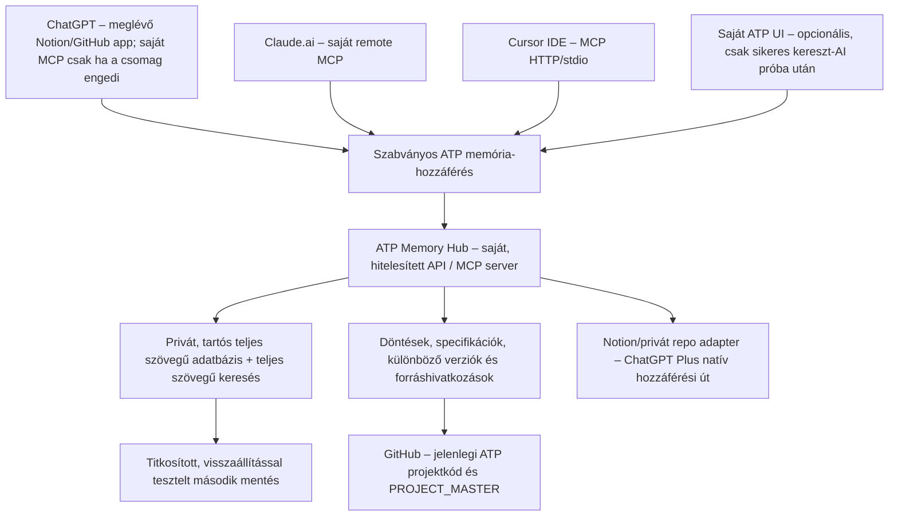

# ATP Intelligence – egyetlen közös memória ChatGPT, Claude, Cursor és más AI-eszközök számára

**Dátum:** 2026-11-22
**Felhasználói végleges feltétel:** saját ATP-felület **csak akkor elfogadható**, ha a közös, tartós projektmemória **innen, a natív ChatGPT-ből**, valamint **Claude AI-ból és Cursorból** is ténylegesen használható. A felhasználó nem akar alkalmazásfüggő archívumot, elvesző kontextust, vagy újra és újra kézi fájlátvitelt.
**Hívószó:** `ATP`.
**Státusz:** keresztplatformos architektúra- és elfogadási specifikáció; **MCP szerver még nincs elkészítve/telepítve/tesztelve**; a natív chat-ek automatikus, teljes szövegű archiválása még nincs bizonyítva.

## Kötelező architektúra
**NE a külön chatfelülettel kezdjük**. Előbb készüljenek a szolgáltatás- és adatfelületek; a saját felület csak opcionális, egy újabb kliens.

## 1. A valós támogatottság, 2026-11-22
| Kliens | Ugyanazon memória visszaolvasása | Ugyanazon memória írása | Teljes natív chat automatikus eltárolása |
|---|---|---|---|
| **ChatGPT (jelenlegi csomag)** | **Már meglevő GitHub és Notion pluginokon keresztül lehetséges**, ezeket ténylegesen használtuk az ATP projekthez | Támogatott GitHub/Notion műveletekkel igen | **Nem garantált**: a plugin **nem** kap automatikusan minden user/assistant üzenetet |
| **ChatGPT saját remote MCP** | OpenAI hivatalos dokumentáció: **teljes saját MCP hozzáférés Business és Enterprise/Edu**; Pro felhasználóknál read/fetch korlátozott; Plus jogosultsága nem tekinthető bizonyítottnak | Csomag/jogosultságfüggő | MCP önmagában **itt sem** automatikus natív beszélgetésnaplózás |
| **Claude.ai** | Anthropic hivatalos remote MCP custom connector bármely, jogosult Claude csomagban (Free/Pro/Max/Ultra/Team/Enterprise) | MCP tool és hozzáférés szerint | Nem automatikus – a natív beszélgetés külön export/capture csatornát igényel |
| **Cursor** | Hivatalos `stdio`, SSE, `Streamable HTTP` MCP; projekt/global konfiguráció | Engedélyezett MCP toolon át | Nem garantált: teljes chat-log gyűjtésének külön műszaki ellenőrzése szükséges |
| **Saját privát ATP chatfelület, később** | Közvetlen saját API és memória | Igen | **Igen, megvalósítható**, ha minden esemény maga a kontrollált kliensoldali/ szerveroldali rögzítési folyamat része, és a mentés/visszaolvasás integrációs tesztje sikeres |

**Hivatalos referenciák:**
- OpenAI: https://help.openai.com/en/articles/12584461-connecting-custom-mcp-servers-in-chatgpt
- Claude: https://support.claude.com/en/articles/11176164-use-connectors-to-extend-claude-s-capabilities
- Cursor: https://cursor.com/docs/mcp
- Notion MCP: https://www.notion.com/en-gb/help/notion-mcp
- MCP specifikáció: https://modelcontextprotocol.io/specification/2025-11-25/basic/authorization

## 2. Első, azonnal hasznos verzió (nem kell még külön felület)
**Single source of truth:** az ATP projektkódra GitHub, az elfogadott döntések és visszakereshető kutatási dokumentumok tárolására egy közös, privát strukturált tároló (kezdetben a már integrált Notion, később natív ATP DB + Notion adapter). **Nem két, egymásnak ellentmondó „mesterpéldányt” építünk.**

- ChatGPT-ben az **itt már ténylegesen elérhető Notion és GitHub pluginok** keresik/olvassák a projektet.
- Claude és Cursor csatlakozik ugyanahhoz a Notion-adattérhez vagy a később létrehozott ATP MCP-hez.
- A privát teljes transzkriptek **nem** kerülnek automatikusan a jelenlegi **public** GitHub repóba; külön privát tárban maradnak.
- Az eredeti ATP(1).txt már megvan a felhasználó privát ChatGPT Library-jában és a privát ChatGPT Space-ben. Az ott tárolt forrásba a Claude/Cursor automatikus hozzáférése **NEM** garantált; keresztplatformos leválasztáskor a jövőbeli privát közös DB-be egyszer kell átvezetni a fájlt.
- **Előbb három kliensből ugyanazt az ATP-döntést és azonos rekordverziót kell visszaolvasni**; addig nem érdemes külön UI-fejlesztésbe kezdeni.

## 3. A későbbi ATP MCP / memória API
Minimális eszközszerződés:
- `atp_search(query, date_range?, scope?)` – döntések, forrásbeszélgetések és fájlok.
- `atp_get_decision(decision_id)` – állapot, előző/szuperszedált döntések, hivatkozások.
- `atp_get_message(conversation_id, message_id)` – **eredeti** szereplő, teljes üzenetszöveg, időpont.
- `atp_get_current_state()` – GitHub commit, megvalósult/még hiányzó funkciók, futó specifikáció.
- `atp_save_decision(text, source_message_ids, replaces_id?)` – idempotens, időbélyeges, verziózott döntés.
- `atp_append_message(conversation_id, message_id, role, content, created_at, source)` – forrás/üzenet ID alapján deduplikált üzenetbeírás, **csak amikor az integráció ténylegesen megkapta a teljes üzenetet**; MCP tool nem látja automatikusan a natív app minden üzenetét.
- `atp_list_sources()`, `atp_archive_status()` – ellenőrizhető lefedettség, hiány, mentési állapot, források.

A teljes transzkript tárolója legyen külön a szemantikus döntésmemóriától. A döntésmemória tételesen az eredeti forrásrekordra hivatkozzon (conversation_id, message_id, részlet, verzió), `USER_CONFIRMED / PROPOSAL / SUPERSEDED / IMPLEMENTED / VALIDATED` státusszal. Tároláshoz SQLite az MVP-ben, később PostgreSQL, ha a kliensszám/keresés/backup indokolja. Fájlbájtok és csatolmányok hash-el, külön privát fájltárolóban.

## 4. Az automatikus rögzítés nem azonos az MCP-olvasással
- **Az MCP a hozzáférési/lekérdezési szabvány.** Szó szerinti, teljes automatikus naplózáshoz **capture producer** szükséges, amely minden új ChatGPT/Claude/Cursor user- és asszisztensüzenethez megbízhatóan hozzáfér.
- A natív ChatGPT/Claude/Cursor rendszerek nem adnak minden csomagban garantált, minden üzenetre működő, valós idejű, külső exportot.
- Ha a felhasználó **ragaszkodik a natív AI felületekhez**, célként marad a három appból visszakereshető **közös projektmemória**. A teljes natív chattörténet automatikus archiválása külön, platformonként ellenőrzendő export/integráció, nem már elvégzett funkció.
- Ha **minden mondat teljes, automata archiválása kötelező**, a legbiztosabb architektúra a kontrollált ATP kliens, amely a mentést a chat elküldése/megérkezése előtt vagy annak tranzakciós részeként végzi. A közös memória ezután MCP-n keresztül továbbra is elérhető ChatGPT-ben, Claude-ban és Cursorban is.
- Nincs garancia arra, hogy a natív ChatGPT Plus szolgáltatás **bármely saját külső privát MCP** szervert közvetlenül csatlakoztatni enged; ezért az első cross-app ChatGPT olvasási út az itt már működő **Notion/GitHub plugin** és egy privát adat-projekció, nem egy ellenőrizetlen Plus-MCP ígéret.

## 5. Kötelező elfogadási tesztek – mielőtt saját felület készül
1. ChatGPT, Claude és Cursor **ugyanazt az ATP tesztrekordot** olvassa, a verzió, létrehozó és forrásoldal egyezik.
2. Legalább két kliens tud **új, időbélyeges tesztdöntést** felvenni; harmadikból azonos verzióban látható.
3. Egy „felülírt” döntést az egyik kliens már nem állít aktívnak, de az eredeti bejegyzés/forrás továbbra is megvan.
4. A 2025–2026-os H2H szabály és a Tennis API korábban lezárt engedély mindhárom eszközből pontosan ugyanúgy visszakereshető.
5. A teljes szövegű privát archívum kereshető, és az eredeti 1006 sor hiánytalanul elérhető, **nem csak összefoglalva**.
6. A „minden új üzenet automata mentése” csak akkor kap **PASS** státuszt, ha a konkrét felületen a rögzítő működik; a ChatGPT/Claude/Cursor natív felületére ekkor sem állíthatunk általános garanciát.
7. Biztonság: privát adatbázis, külön read/write tokenek, TLS/OAuth, kulcsok nem nyilvános repóban, audit napló, mentés-visszaállítás próba.

## Döntés és következő munkasorrend
**Felhasználói architektúra-feltétel: elfogadva.** Nincs alkalmazáshoz zárt ATP-memória. A felhasználó egy **megosztott, több AI-ból használható projektmemóriát** akar és csak ennek bizonyítása után mérlegel külön felületet.
**Javasolt, nem jóváhagyott konkrét implementáció:** közös, privát ATP DB + MCP API + ChatGPT natív Notion/GitHub adapter; Claude/Cursor MCP.
**Megvalósítási állapot:** **nincs tesztelt cross-AI memória szinkron vagy működő saját MCP szerver**. A GitHub és Notion kapcsolatok a ChatGPT-ből már használhatók; a többi AI-hoz külön kapcsolat-engedélyezés kell.

**Kérdésként újra NE tegye fel a követelményt:** „csak akkor jó saját felület, ha ChatGPT + Claude + Cursor ugyanahhoz az ATP-memóriához hozzáfér”. Ezt a feltételt állandóan meg kell őrizni.
