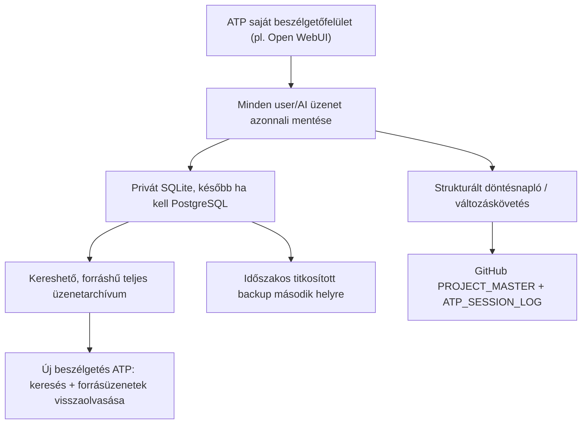

# ATP – teljes beszélgetésarchívum és valódi, tartós projektmemória

**Frissítés:** 2026-11-22
**Felhasználói követelmény:** ne csak összefoglaló/kiemelt döntés maradjon meg. **Minden** új felhasználói és asszisztensi üzenet teljes szövege, időrendje és lehetőség szerint az eredeti mellékletek hivatkozása **automatikusan** legyen tartósan eltárolva, és az új szálból teljes szövegre kereshetően legyen visszahozható. **A felhasználó nem akar ismétlődő exportokat, feltöltéseket, újramagyarázást.**

## A két problémát nem szabad összekeverni
1. **Tárolás / veszteségmentesség:** egyetlen új mondat sem veszhet el az archívumból, ha már sikeresen elküldték. Ehhez a beszélgetési felületnek vagy hozzáféréssel rendelkező rögzítőnek minden üzenetet **eseményenként** írnia kell az adatbázisba. A tartós GitHub/Notion/Space **önmagában NEM automatikus beszélgetésmásoló**.
2. **Az AI hosszú távú kontextusa:** egy teljes adatbázist lehet keresni, de a teljes sokszáz-ezer soros archívum nem fér egyetlen modellpromptba. Pontos válaszhoz **search → releváns forrásrekordok visszaolvasása → időbélyeges hivatkozás → válasz** lánc kell. Egy általános összefoglaló nem helyettesíti ezt.

## Elsődleges ajánlott út, ha teljesen automatikus archiválás a cél
**Saját, privát, az ATP beszélgetést rögzítő felület + tartós adatbázis.** A minimális költségű, kész, nyílt forrású kiindulási lehetőség az **Open WebUI** (https://docs.openwebui.com/features/chat-conversations/chat-features/history-search/).

A hivatalos Open WebUI dokumentáció szerint:
- minden, azon a felületen folytatott beszélgetést automatikusan elment a saját `webui.db` adatbázisába;
- a korábbi üzenetek kereshetők, `search_chats` és `view_chat` eszközökkel modellből is visszakereshetők, ha a tool calling be van állítva;
- JSON export és ChatGPT export JSON import támogatott: https://docs.openwebui.com/features/chat-conversations/data-controls/import-export/ ;
- a beszélgetéshez megfelelő OpenAI vagy más provider csatlakoztatása **külön, jogosultság-/költségfüggő** feladat. ChatGPT Plus általában **nem tartalmaz hagyományos OpenAI API díjat** (https://help.openai.com/en/articles/6950777-what-is-chatgpt-plus).
- Egyes résztvevő külső alkalmazásoknál a **Sign in with ChatGPT** keretében a Plus felhasználó engedélyezhet előfizetéses AI használatot; ez **nem jelenti**, hogy maga az Open WebUI hivatalosan támogatott, és a bejelentkezés sem ad hozzáférést a régi ChatGPT chatekhez. https://help.openai.com/en/articles/20001542-using-your-chatgpt-plan-in-other-apps-and-sites .

## Megoldási architektúra

### Minimális, ellenőrizhető tárolási séma
- `conversation_id`, `message_id`, `parent_message_id`, `role` (user/assistant/tool), `text`, `message_timestamp_utc`, `captured_at_utc`, `edited_from_id`, `source`, `attachment_refs`, `hash_sha256`, `delivery_status`.
- Az eredeti üzenetek soha nem felülírt, **append-only** vagy verziózott adatok. Utólagos szerkesztés új verzió.
- A modell/AI által készített **rövid döntésnapló** külön táblázat: `decision_id`, `decision`, `state` (accepted/superseded/proposal), `source_message_ids`, `github_commit`, `updated_at`.
- **RAG/search** hivatkozik a pontos üzenet-id-ra és szövegrészletre; nem állítunk 100%-os visszaemlékezést attól, hogy az összes adat megvan.
- Állományok: mellékletek, eredeti feltöltések külön privát mappában checksum-mal; a hosszú chat JSON import egyes beágyazott képeket/fájlokat **nem feltétlenül** migrál automatikusan.

## Migráció egyszer
1. Eredeti ChatGPT projekt + teljes ChatGPT adatexport: **Settings → Data Controls → Export Data**. E-mail/letöltési link és ZIP; a ZIP teljes elérhető chatelőzményt JSON-ként tartalmazhat. https://help.openai.com/en/articles/7260999-exporting-your-chatgpt-history-and-data
2. Az eredeti ZIP **bizalmas**; csak saját tárolóba. A beszélgetések importálása/duplikációkezelése a kiválasztott archív felületen. A korábbi export meglévő, törölt üzeneteket nem állít vissza.
3. Import után **darabszám és ellenőrzés**: időbélyeg, beszélgetésszám, üzenetszám, néhány hosszú ATP döntés visszakeresése. A ChatGPT exportból egyes eszközfuttatások és mellékletek másképpen jelenhetnek meg.
4. A ChatGPT felületről **átállás az új felületre**: innentől az üzenetek automatikusan ugyanabba az adatbázisba érkeznek. A régi natív ChatGPT böngészőben külön folytatott üzenetek **nem** szinkronizálódnak automatikusan.
5. Tartós mentési teszt: új üzenet → azonnal adatbázisba ment → teljes szöveg visszaolvas → új chatben forráshivatkozással keres → visszaállítás backupból.

## Ha a felhasználó nem akarja elhagyni a ChatGPT web/app felületét
- **ChatGPT Project + Memory + csatlakoztatott GitHub/Notion**: használható projektfolytonosság a legfontosabb döntésekhez; **nem** szóról szóra automatikus beszélgetésexport.
- **Hivatalos ChatGPT ZIP Export Data**: megbízható adatmentési út, de **kézi indítású** és nem valós idejű.
- **Böngészőkiegészítő/automata DOM rögzítő**: technikailag lehetséges, de külön fejlesztés, jogosultság, biztonsági és ChatGPT UI-változás miatti hibakockázat; nem ajánlott titkokkal teli beszélgetést ellenőrizetlen harmadik félnek átengedni. Egy olvasásra jogosult bővítmény hozzáférhet a megnyitott chat tartalmához.
- **ChatGPT Compliance API**: a dokumentáció szerint Enterprise/Edu jogosultságokhoz kapcsolódik; nem feltételezhető általános Plus-fiókban.
- Egy tárolóplugin (Notion/GitHub/Supabase) csak azt tárolja, amit **valamilyen rögzítő valóban elküld neki**. Tárolókiválasztás nem oldja meg az automata üzenetbeolvasást.

## Döntési státusz 2026-11-22
**Elfogadott felhasználói követelmény:** teljes, automatikusan rögzített szöveges chat-archívum minden jövőbeli ATP-szálhoz, és külső tartós memóriára való aktív visszakereshetőség.  
**Még nem jóváhagyott architektúraváltás:** Open WebUI vagy saját külön privát ATP frontend. Ez reális, ellenőrizhető jelölt, de még **nem telepített**, ezért nincs teljes jövőbeli auto-archívum.
**Már meglévő:** `ATP(1).txt` az eredeti fájl személyes Library archívumában, szöveges másolata privát ChatGPT Space-ben, a projektkód és döntések GitHubon; az `ATP` hívószó és indítási útmutató.

## Adatvédelmi minimum
- A teljes beszélgetés **NE** kerüljön a jelenleg nyilvános GitHub repóba. Sem token, sem privát teljes chat.
- Lokális tárolás esetén titkosított eszköz és offline/remote titkosított backup; felhasználói hitelesítés; lehetőleg ne tegyük nyilvánosan internetre a chat UI-t.
- A használat megfelelőségét a kiválasztott backend és AI provider adatkezelési feltételeihez kell mérni.

## 2026-11-22 – Platformfüggetlen memória követelmény – elsőbbség

A felhasználó egyértelműen pontosította: **külön ATP-beszélgetőfelület önmagában NEM jó**. Csak akkor elfogadható, ha ugyanaz a tartós projektmemória a *natív ChatGPT-ből, Claude.ai-ból és Cursorból* is használható. **Ez felülírja a korábbi automatikus ajánlást, hogy azonnal Open WebUI-ra váltsunk.** Először a három kliens integrálhatóságát és a közös verziózott forrástárat bizonyítjuk. Részletes terv: [ATP_CROSS_AI_SHARED_MEMORY_MCP_ARCHITECTURE.md](ATP_CROSS_AI_SHARED_MEMORY_MCP_ARCHITECTURE.md). MCP a visszakeresés és engedélyezett írás szabványa, de a natív ChatGPT/Claude/Cursor összes üzenetének automatikus beolvasását/archiválását **nem** biztosítja magától.
